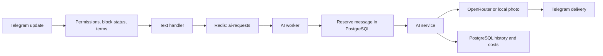

# Architecture

**English** · [Русский](../ru/architecture.md) · [简体中文](../zh/architecture.md)

[Documentation](../../README.md#documentation)

One Node.js process hosts Telegram polling, two BullMQ workers, and schedulers. PostgreSQL stores business data; Redis stores queued jobs.

## Module boundaries

| Location                     | Responsibility                                                              |
| ---------------------------- | --------------------------------------------------------------------------- |
| `src/main.ts`                | Load configuration, start the application, report startup failure.          |
| `src/bootstrap/`             | Compose adapters, register handlers, manage resources.                      |
| `src/config/`                | Validate the environment before services start.                             |
| `src/constants/`             | Named limits, timeouts, rewards, package defaults and provider settings.    |
| `src/messages/`              | User-facing text, typed formatters, error/log messages, prompts and themes. |
| `src/types/`                 | Models and contracts for repositories, services, and handler dependencies.  |
| `src/domain/`                | Payment validation, input validation, roles.                                |
| `src/application/`           | AI use cases, catalog, payments, sessions, timers.                          |
| `src/infrastructure/`        | PostgreSQL, Redis/BullMQ, OpenRouter, Platega, local photos.                |
| `src/presentation/telegram/` | Middleware, menus, delivery, shop, administrator interface.                 |

Domain and application modules depend on contracts; adapters implement them. Factories receive dependencies, and [bootstrap/runtime.ts](../../src/bootstrap/runtime.ts) wires concrete implementations. Importing modules does not start the application; connections are created when their factories run.

Use `import type` from a focused `@contracts/*` file. `User` lives in `types/user.ts`; `PurchaseIntent` lives in `types/purchases.ts`. ESLint disallows ordinary imports and exported executable declarations inside `src/types/`.

## Text request flow

The handler limits ordinary user requests to 1000 characters and a five-second interval; the administrator is exempt from those checks. Custom system prompts have a 1000-character limit for everyone.

The worker validates `AiJob`, atomically reserves a message when `shouldDecrement` is enabled, and refunds it for `chargeText !== true` or a handled failure. The AI service separately applies a local 10-request minute window and reserves photos.

The last 10 stored messages are sent to the model. Responses are delivered after generation, without streaming. Text is split at 4096 characters and photo captions at 1024. Model parameters are defined in `src/constants/ai.ts` and consumed by the OpenRouter adapter.

## Persistence

[repository.ts](../../src/infrastructure/database/repository.ts) composes `users`, `conversations`, `balances`, `settings`, `promotions`, `campaigns`, and `administration`. The separate `purchases` adapter implements transactional `PurchaseStore` fulfillment.

| Table                           | Data                                                              |
| ------------------------------- | ----------------------------------------------------------------- |
| `users`                         | Telegram identity, balances, block status, roles, bonuses, costs. |
| `messages`                      | Conversation history and recorded response cost.                  |
| `global_settings`               | Content, package, and bonus settings.                             |
| `promocodes`, `user_promocodes` | Promo codes and per-user usage counts.                            |
| `purchase_intents`              | Purchase snapshot, provider transaction, fulfillment state.       |
| `payments`                      | Credited payment history and unique `tx_id`.                      |
| `payment_failures`              | Invoice creation failures recorded by the Platega adapter.        |
| `schema_migrations`             | Applied migration names.                                          |

Contracts represent database `BIGINT` identifiers and `NUMERIC` aggregates as strings. Incoming `UserId` accepts a string or number and is validated at boundaries. Check range before converting database values to JavaScript numbers.

## Queues and schedules

| Mechanism                      | Configuration                                                                        |
| ------------------------------ | ------------------------------------------------------------------------------------ |
| `ai-requests`                  | Concurrency 5, one configured attempt, `telegram-<update_id>` job ID.                |
| `broadcast`                    | Concurrency 1, 35 ms delay after successful delivery, one configured attempt.        |
| Completed/failed job retention | Up to 1000 jobs of each category per queue.                                          |
| Platega polling                | Every 30 seconds; batches of up to 100 pending purchases created in the last 7 days. |
| Reminders                      | Every 5 minutes.                                                                     |
| Session cleanup                | Every 15 minutes; remove sessions inactive for over 30 minutes.                      |

`Timers` prevents overlapping runs of the same scheduled task. Slow provider requests can extend the effective polling interval.

## Lifecycle

Startup validates configuration, creates the pool, applies migrations in a transaction under an advisory lock, wires services and handlers, checks Telegram with `getMe`, starts workers, waits for Redis readiness, installs signal handlers, then starts polling.

On `SIGINT`/`SIGTERM`, polling stops; timers and active scheduled work are awaited; current Telegram updates are awaited; workers, queues, and the pool close. Repeated shutdown requests share one completion Promise.

Atomic balances prevent concurrent overspending, but external AI requests are not exactly-once. There is no separate crash-recovery ledger for reservations. Sessions and local limits are not shared across processes. See [operations](operations.md).

## Constants and messages

Use `@constants/*` for policy and runtime values, and `@messages/*` for text. Shared buttons live in `messages/common.ts`; errors and logs have separate catalogs. Keep dynamic text in typed formatter functions, and derive displayed limits and rewards from the same constants used by services. ESLint rejects magic numbers and inline error/Telegram reply strings in implementation modules; zero, one, array indexes and type literals retain their structural meaning.
