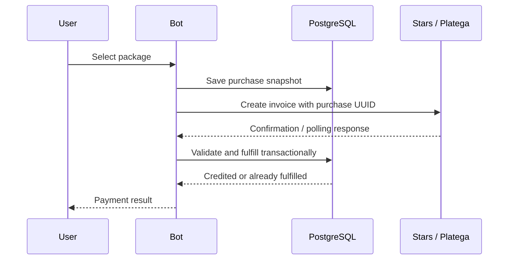

# Payments and balances

**English** · [Русский](../ru/payments.md) · [简体中文](../zh/payments.md)

[Documentation](../../README.md#documentation)

A purchase snapshot is saved before an invoice is issued. Later price changes do not change the amount or resources in an existing purchase.

## Packages

Defaults from [packages.ts](../../src/constants/packages.ts):

| Package  | Stars | RUB | Messages | Photos |
| -------- | ----: | --: | -------: | -----: |
| `t50`    |    35 |  50 |       50 |      0 |
| `t200`   |   125 | 150 |      200 |      0 |
| `t500`   |   250 | 300 |      500 |      0 |
| `i5`     |    35 |  50 |        0 |      5 |
| `i15`    |   125 | 150 |        0 |     15 |
| `i50`    |   300 | 390 |        0 |     50 |
| `lite`   |    65 |  80 |       50 |      5 |
| `medium` |   150 | 200 |      200 |     20 |
| `hard`   |   350 | 500 |      500 |     50 |
| `full`   |   750 | 999 |     1000 |    100 |

`full` exists in the catalog and administrator settings but is not shown in the ordinary shop menu. Database `pkg_<name>` values override defaults, encoded as `Stars_RUB_Messages_Photos`. The catalog migrates legacy three-field values on read.

Discounts are rounded to an integer and keep a minimum price of 1. A photo request uses the text flow; outside Free Mode, a photo-only package cannot be used while the message balance is zero.

## Purchase snapshots

`purchase_intents` stores the purchase UUID, user, provider, package, resource counts, amount, currency, and provider transaction. State fields are `fulfilled_at`, `canceled_at`, and `checked_at`.

The invoice payload is `purchase:<UUID>`. Resource counts are read from the stored snapshot, not trusted from the payload.

## Telegram Stars

[stars.ts](../../src/presentation/telegram/shop/stars.ts) issues an invoice in `XTR` with an empty `provider_token`.

`pre_checkout_query` checks the snapshot, owner, amount, currency, provider, and fulfillment state. `successful_payment` uses the real `telegram_payment_charge_id`. Repeated updates must not credit twice.

After a newly credited Stars purchase, an unset/default starter flirt prompt switches to `default`; other explicitly chosen prompts remain. This behavior belongs to the Stars handler.

## Platega

Both `PLATEGA_MERCHANT_ID` and `PLATEGA_SECRET` are required. The menu supports methods `2` and `13`, labeled SBP and cryptocurrency.

The provider transaction is bound to the snapshot after invoice creation. Users can check through a button; the scheduler also polls. No HTTP callback endpoint is implemented.

Every 30 seconds, a batch selects up to 100 unfulfilled, uncanceled purchases with a transaction and age below 7 days. `checked_at` rotates selection. PostgreSQL restores the polling state after restart. Sequential requests and the 15-second HTTP timeout can extend a polling pass.

`CONFIRMED` requires matching payload, amount, currency, and transaction. `CANCELED` and `CHARGEBACKED` close pending purchases. Provider unavailability keeps the purchase eligible for later checks. Purchases older than 7 days leave automatic selection; an existing purchase can still be checked manually.

## Single fulfillment

[PurchaseStore.fulfill](../../src/infrastructure/database/purchases.ts) performs one transaction:

1. Lock the purchase with `FOR UPDATE` and validate payment proof.
2. Check `fulfilled_at` and insert unique `payments.tx_id` with a provider prefix.
3. Credit resources, set `has_purchased`, and clear the discount.
4. Record transaction/fulfillment time and clear conversation history.

Errors roll back the transaction. `false` means that this purchase was already fulfilled; it does not authorize an additional manual credit.

## Boundaries

- Automatic refunds and reversal of previously credited resources after a late chargeback are not implemented. Fulfilled purchases are not polled.
- Legacy invoices without a stored snapshot require provider reconciliation before any manual grant.
- Message and photo reservations refund on handled failures; a separate crash-recovery mechanism is not implemented.
- Unique payment fulfillment does not guarantee exactly-once Telegram notifications or external AI generation.

Use the purchase UUID and provider transaction for support. Merchant secrets and full conversation history are not needed for payment diagnosis. See [operations](operations.md#diagnostics).
