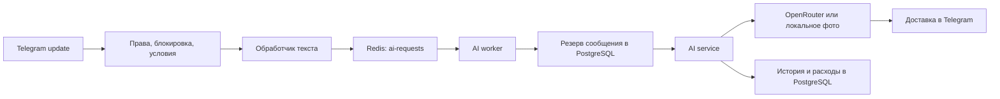

# Архитектура

[English](../eng/architecture.md) · **Русский** · [简体中文](../zh/architecture.md)

[К документации](../../README.ru.md#документация)

Приложение — один Node.js-процесс: Telegram polling, два BullMQ-воркера и планировщики. PostgreSQL хранит бизнес-данные, Redis — задания очередей.

## Границы модулей

| Каталог                      | Ответственность                                                                |
| ---------------------------- | ------------------------------------------------------------------------------ |
| `src/main.ts`                | Загрузка конфигурации, запуск и обработка ошибки старта.                       |
| `src/bootstrap/`             | Создание адаптеров, регистрация обработчиков, управление ресурсами.            |
| `src/config/`                | Проверка окружения до запуска сервисов.                                        |
| `src/constants/`             | Именованные лимиты, таймауты, бонусы, исходные пакеты и настройки провайдеров. |
| `src/messages/`              | Тексты, типизированные форматтеры, ошибки и логи, промпты и темы.              |
| `src/types/`                 | Модели, контракты репозиториев, сервисов и зависимостей обработчиков.          |
| `src/domain/`                | Проверки платежей, валидация, роли.                                            |
| `src/application/`           | Сценарии AI, каталог, платежный сервис, сессии и таймеры.                      |
| `src/infrastructure/`        | PostgreSQL, Redis/BullMQ, OpenRouter, Platega и локальные фотографии.          |
| `src/presentation/telegram/` | Telegram middleware, меню, доставка сообщений, магазин и админка.              |

Домен и прикладные сервисы используют контракты вместо прямого импорта инфраструктуры. Зависимости передаются фабрикам. Сборкой конкретных реализаций занимается [bootstrap/runtime.ts](../../src/bootstrap/runtime.ts). Импорт модулей не запускает приложение; подключения создаются при вызове соответствующих фабрик.

Общие типы импортируются через `import type` из тематического `@contracts/*`. Например, `User` находится в `types/user.ts`, `PurchaseIntent` — в `types/purchases.ts`. В `src/types/` ESLint запрещает обычные импорты и экспорт исполняемых функций, классов и переменных.

## Текстовый запрос

Обработчик ограничивает размер обычного запроса до 1000 символов и интервал между запросами пользователя до 5 секунд; администратор освобождён от этих двух проверок. Пользовательский системный промпт ограничен 1000 символами и для администратора.

Воркер получает `AiJob`, валидирует поля и атомарно резервирует сообщение, если `shouldDecrement` включён. При `chargeText !== true` или обработанной ошибке резерв возвращается. AI-сервис отдельно ограничивает пользователя до 10 запросов за локальное минутное окно и отдельно резервирует фото.

Последние 10 сообщений из БД передаются модели. Ответы отправляются после завершения генерации, без streaming; текст разбивается по лимиту 4096 символов, подпись фото — по 1024. Модели и их параметры задаются в `src/constants/ai.ts` и используются адаптером OpenRouter.

## Репозитории и таблицы

[repository.ts](../../src/infrastructure/database/repository.ts) собирает фасад из адаптеров `users`, `conversations`, `balances`, `settings`, `promotions`, `campaigns`, `administration`. Отдельный `purchases` реализует `PurchaseStore` и транзакционное зачисление покупок.

| Таблица                         | Данные                                                             |
| ------------------------------- | ------------------------------------------------------------------ |
| `users`                         | Telegram ID, профиль, балансы, блокировка, роли, бонусы и расходы. |
| `messages`                      | История диалога и учтённая стоимость ответов.                      |
| `global_settings`               | Настройки контента, магазина и бонусов.                            |
| `promocodes`, `user_promocodes` | Промокоды и число использований пользователями.                    |
| `purchase_intents`              | Снимок покупки, транзакция провайдера и состояние зачисления.      |
| `payments`                      | История зачисленных платежей и уникальный `tx_id`.                 |
| `payment_failures`              | Ошибки создания платежей Platega, записанные адаптером.            |
| `schema_migrations`             | Имена применённых миграций.                                        |

В контрактах ID, возвращаемые PostgreSQL как `BIGINT`, и денежные агрегаты `NUMERIC` представлены строками. Входной `UserId` допускает строку и число; на границах проверяется корректность ID. Не приводите все значения БД к `number` без проверки диапазона.

## Очереди и фоновые задачи

| Механизм                        | Параметры                                                                     |
| ------------------------------- | ----------------------------------------------------------------------------- |
| `ai-requests`                   | Параллелизм 5; одна настроенная попытка; ID задания `telegram-<update_id>`.   |
| `broadcast`                     | Параллелизм 1; пауза 35 мс после успешной отправки; одна настроенная попытка. |
| Сохранение результатов очередей | До 1000 успешных и до 1000 неуспешных заданий на очередь.                     |
| Проверка Platega                | Каждые 30 секунд; до 100 ожидающих счетов за проход, возрастом до 7 дней.     |
| Напоминания                     | Каждые 5 минут.                                                               |
| Очистка сессий                  | Каждые 15 минут; удаляются состояния с неактивностью более 30 минут.          |

`Timers` не запускает следующий экземпляр одной периодической задачи, пока предыдущий не завершён. Долгий опрос провайдера может увеличить фактический интервал проверок.

## Запуск и остановка

1. Проверить окружение и создать пул PostgreSQL.
2. Применить миграции в транзакции под advisory lock.
3. Создать сервисы, очереди, обработчики и таймеры.
4. Проверить Telegram через `getMe`, запустить воркеры и дождаться Redis.
5. Установить обработчики сигналов и запустить polling.

На `SIGINT`/`SIGTERM` останавливается polling, закрываются таймеры с ожиданием активных задач, ожидаются текущие Telegram-обработчики, закрываются воркеры, очереди и пул. Повторные запросы остановки используют один Promise завершения.

Баланс защищён от конкурентного перерасхода, но внешние AI-запросы не имеют гарантии exactly-once. Отдельного восстановления резерва после аварийного завершения процесса нет. Сессии и локальные лимиты не разделяются между процессами. Подробности хранения и восстановления: [эксплуатация](operations.md).

## Константы и сообщения

Используйте `@constants/*` для числовых правил и настроек, `@messages/*` — для текстов. Общие кнопки находятся в `messages/common.ts`, ошибки и логи — в отдельных каталогах. Динамический текст оформляйте типизированными функциями; отображаемые лимиты и бонусы берите из тех же констант, что используют сервисы. ESLint запрещает магические числа и встроенные строки ошибок/ответов Telegram в рабочих модулях; ноль, единица, индексы массивов и литеральные типы сохраняют структурное значение.
