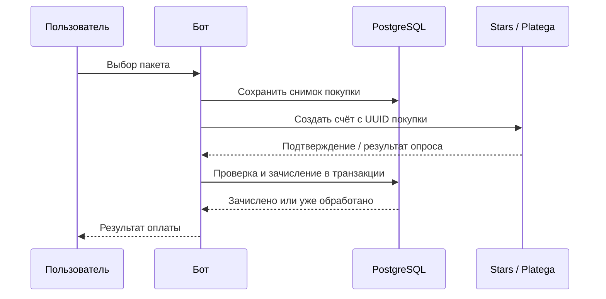

# Платежи и балансы

[English](../eng/payments.md) · **Русский** · [简体中文](../zh/payments.md)

[К документации](../../README.ru.md#документация)

Платёжный сервис сохраняет снимок покупки до выставления счёта. Изменение цены в админке не меняет сумму и состав уже созданной покупки.

## Пакеты

Исходные значения из [packages.ts](../../src/constants/packages.ts):

| Пакет    | Stars | RUB | Сообщения | Фото |
| -------- | ----: | --: | --------: | ---: |
| `t50`    |    35 |  50 |        50 |    0 |
| `t200`   |   125 | 150 |       200 |    0 |
| `t500`   |   250 | 300 |       500 |    0 |
| `i5`     |    35 |  50 |         0 |    5 |
| `i15`    |   125 | 150 |         0 |   15 |
| `i50`    |   300 | 390 |         0 |   50 |
| `lite`   |    65 |  80 |        50 |    5 |
| `medium` |   150 | 200 |       200 |   20 |
| `hard`   |   350 | 500 |       500 |   50 |
| `full`   |   750 | 999 |      1000 |  100 |

Пакет `full` есть в каталоге и настройках администратора, но не выведен в обычном меню магазина. Значения БД `pkg_<имя>` имеют приоритет над исходными значениями. Поля сохраняются как `Stars_RUB_Сообщения_Фото`. Старый формат из трёх полей преобразуется каталогом при чтении.

Скидка применяется к цене, округляется до целого и ограничивается минимальной ценой 1. Фото запрашиваются через текстовый сценарий: при выключенном Free Mode одного пакета фото недостаточно, если баланс сообщений нулевой.

## Снимок покупки

`purchase_intents` содержит UUID покупки, пользователя, провайдера, пакет, число сообщений и фото, сумму, валюту и ID транзакции. Поля состояния: `fulfilled_at`, `canceled_at`, `checked_at`.

В payload передаётся `purchase:<UUID>`. Не используйте payload как доверенный источник количества ресурсов: они берутся из сохранённого снимка.

## Telegram Stars

[stars.ts](../../src/presentation/telegram/shop/stars.ts) создаёт Telegram invoice с валютой `XTR` и пустым `provider_token`.

На `pre_checkout_query` проверяются покупка, владелец, сумма, валюта, провайдер и отсутствие зачисления. На `successful_payment` передаётся фактический `telegram_payment_charge_id`. Повторный update не должен создавать повторное начисление.

После нового успешного платежа Stars исходный или невыбранный промпт переключается в `default`; явно выбранный другой промпт сохраняется. Это отдельная логика Stars-обработчика.

## Platega

Нужны `PLATEGA_MERCHANT_ID` и `PLATEGA_SECRET`. Поддержаны способы с ID `2` и `13`, представленные в меню как СБП и криптовалюта.

После создания счёта ID транзакции привязывается к покупке. Проверка выполняется кнопкой пользователя либо планировщиком. HTTP callback для Platega в приложении не реализован.

Планировщик раз в 30 секунд выбирает до 100 незачисленных и неотменённых счетов с привязанной транзакцией, созданных за последние 7 дней. `checked_at` обеспечивает ротацию выборки. После перезапуска данные берутся из PostgreSQL. Последовательные запросы и таймаут 15 секунд могут увеличить задержку прохода.

При `CONFIRMED` проверяются payload покупки, сумма, валюта и транзакция. `CANCELED` и `CHARGEBACKED` закрывают ожидающий счёт. Сбой провайдера оставляет его для следующей проверки. Счета старше 7 дней автоматически не выбираются; ручная проверка существующей покупки остаётся отдельным сценарием.

## Однократное зачисление

[PurchaseStore.fulfill](../../src/infrastructure/database/purchases.ts) выполняет в одной транзакции:

1. Блокировку строки покупки `FOR UPDATE` и проверку доказательства оплаты.
2. Проверку `fulfilled_at` и вставку уникального `payments.tx_id` с префиксом провайдера.
3. Начисление ресурсов, установку `has_purchased` и сброс скидки.
4. Сохранение транзакции и времени зачисления; очистку истории диалога.

При ошибке изменения откатываются. Возврат `false` означает уже выполненное зачисление этой покупки, а не разрешение повторить его вручную.

## Границы реализации

- Автоматических возвратов и отмены уже начисленных ресурсов при позднем chargeback нет. Зачисленные счета не участвуют в фоновом опросе.
- Старые счета без `purchase_intents` новая версия не зачисляет автоматически. Сверяйте их с провайдером до ручной выдачи.
- Баланс текста резервируется воркером, фото — AI-сервисом. Обработанная ошибка возвращает соответствующий резерв; отдельного восстановления после аварийного завершения нет.
- Уникальность платежа не означает однократную доставку уведомления в Telegram и не делает внешнюю AI-генерацию exactly-once.

В обращении по платежу используйте UUID покупки и ID транзакции; ключи мерчанта и полный пользовательский диалог для диагностики не нужны. Порядок проверки: [эксплуатация](operations.md#диагностика).
