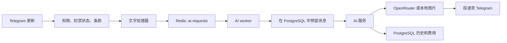

# 架构

[English](../eng/architecture.md) · [Русский](../ru/architecture.md) · **简体中文**

[返回文档](../../README.zh-CN.md#文档)

单个 Node.js 进程包含 Telegram polling、两个 BullMQ worker 和定时任务。PostgreSQL 保存业务数据，Redis 保存队列任务。

## 模块边界

| 位置                         | 职责                                                       |
| ---------------------------- | ---------------------------------------------------------- |
| `src/main.ts`                | 加载配置、启动应用并报告启动失败。                         |
| `src/bootstrap/`             | 组装适配器、注册处理器并管理资源。                         |
| `src/config/`                | 在启动服务前验证环境变量。                                 |
| `src/constants/`             | 具名限制、超时、奖励、默认套餐和提供商设置。               |
| `src/messages/`              | 用户文本、类型化格式函数、错误和日志消息、提示词及主题。   |
| `src/types/`                 | 模型、仓储和服务契约，以及处理器依赖类型。                 |
| `src/domain/`                | 支付校验、输入校验、角色。                                 |
| `src/application/`           | AI 用例、套餐目录、支付、会话和定时器。                    |
| `src/infrastructure/`        | PostgreSQL、Redis/BullMQ、OpenRouter、Platega 和本地图片。 |
| `src/presentation/telegram/` | 中间件、菜单、消息投递、商店和管理界面。                   |

领域和应用层依赖契约，适配器实现契约。工厂接收依赖，[bootstrap/runtime.ts](../../src/bootstrap/runtime.ts) 负责连接具体实现。导入模块本身不会启动应用；调用对应工厂时才创建连接。

通过 `import type` 从主题明确的 `@contracts/*` 文件导入类型。`User` 位于 `types/user.ts`，`PurchaseIntent` 位于 `types/purchases.ts`。ESLint 禁止在 `src/types/` 中使用普通导入或导出可执行声明。

## 文字请求流程

普通用户请求限制为 1000 字符，两次请求至少间隔 5 秒；管理员不受这两项限制。自定义系统提示词对所有人均限制为 1000 字符。

worker 校验 `AiJob`，在启用 `shouldDecrement` 时原子地预留消息额度。若 `chargeText !== true` 或发生已处理的错误，则返还预留。AI 服务还单独执行每个本地分钟窗口 10 次请求的限制，并预留图片额度。

模型接收最近 10 条历史消息。结果在生成完成后发送，不使用流式输出；文字按 4096 字符、图片说明按 1024 字符拆分。模型参数位于 OpenRouter 适配器中。

## 数据持久化

[repository.ts](../../src/infrastructure/database/repository.ts) 组合 `users`、`conversations`、`balances`、`settings`、`promotions`、`campaigns` 和 `administration`。独立的 `purchases` 适配器通过 `PurchaseStore` 在事务中处理入账。

| 表                              | 数据                                          |
| ------------------------------- | --------------------------------------------- |
| `users`                         | Telegram 身份、余额、封禁、角色、奖励和费用。 |
| `messages`                      | 对话历史和已记录的响应费用。                  |
| `global_settings`               | 内容、套餐和奖励设置。                        |
| `promocodes`、`user_promocodes` | 优惠码和用户使用次数。                        |
| `purchase_intents`              | 订单快照、支付平台交易和入账状态。            |
| `payments`                      | 已入账支付记录和唯一 `tx_id`。                |
| `payment_failures`              | Platega 适配器记录的账单创建失败。            |
| `schema_migrations`             | 已应用的迁移名称。                            |

契约使用字符串表示数据库返回的 `BIGINT` 标识和 `NUMERIC` 汇总值。输入 `UserId` 可为字符串或数字，并在边界处校验。转换成 JavaScript 数字前应检查范围。

## 队列和定时任务

| 机制          | 配置                                                        |
| ------------- | ----------------------------------------------------------- |
| `ai-requests` | 并发 5，配置为一次尝试，任务 ID 为 `telegram-<update_id>`。 |
| `broadcast`   | 并发 1，成功投递后等待 35 毫秒，配置为一次尝试。            |
| 任务结果保留  | 每个队列最多保留 1000 个成功及 1000 个失败任务。            |
| Platega 轮询  | 每 30 秒；每批最多 100 个过去 7 天内的待处理订单。          |
| 提醒          | 每 5 分钟。                                                 |
| 会话清理      | 每 15 分钟；删除超过 30 分钟不活跃的状态。                  |

`Timers` 防止同一个周期任务重叠运行。平台请求较慢时，实际轮询间隔会延长。

## 生命周期

启动时依次验证配置、创建连接池、在 advisory lock 保护的事务中迁移数据库、组装服务和处理器、通过 `getMe` 检查 Telegram、启动 worker 并等待 Redis 就绪，最后安装信号处理器并启动 polling。

收到 `SIGINT` 或 `SIGTERM` 后停止 polling，关闭定时器并等待活动任务，等待当前 Telegram 更新，依次关闭 worker、队列和连接池。重复停止请求共享同一个完成 Promise。

原子余额操作防止并发超额扣减，但外部 AI 调用不保证 exactly-once。预留额度没有独立的崩溃恢复账本；会话和本地限流不跨进程共享。参见[运维](operations.md)。

## 常量与消息

使用 `@constants/*` 管理规则和运行参数，使用 `@messages/*` 管理文本。通用按钮位于 `messages/common.ts`，错误和日志分别存放。动态文本使用类型化格式函数；展示的限制和奖励应引用服务使用的同一常量。ESLint 禁止业务模块中的魔法数字和内联错误/Telegram 回复文本；零、一、数组索引和字面量类型保留其结构含义。
