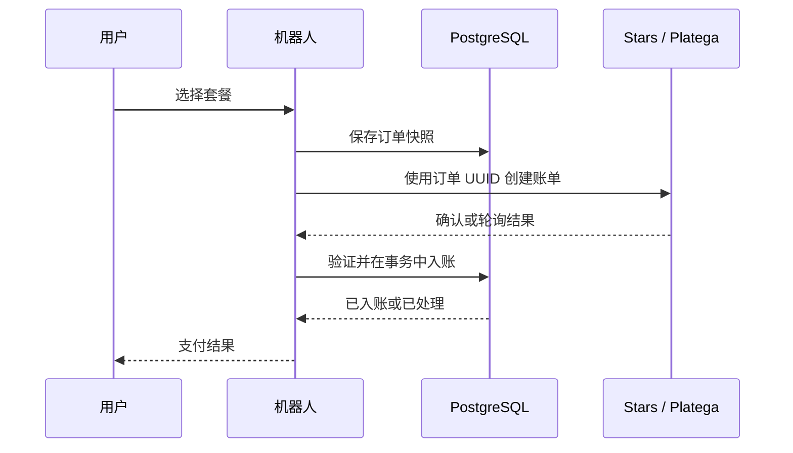

# 支付与余额

[English](../eng/payments.md) · [Русский](../ru/payments.md) · **简体中文**

[返回文档](../../README.zh-CN.md#文档)

开具账单前先保存订单快照。之后修改价格，不会改变已创建订单的金额和资源数量。

## 套餐

默认值来自 [packages.ts](../../src/domain/packages.ts)：

| 套餐     | Stars | RUB | 消息 | 图片 |
| -------- | ----: | --: | ---: | ---: |
| `t50`    |    35 |  50 |   50 |    0 |
| `t200`   |   125 | 150 |  200 |    0 |
| `t500`   |   250 | 300 |  500 |    0 |
| `i5`     |    35 |  50 |    0 |    5 |
| `i15`    |   125 | 150 |    0 |   15 |
| `i50`    |   300 | 390 |    0 |   50 |
| `lite`   |    65 |  80 |   50 |    5 |
| `medium` |   150 | 200 |  200 |   20 |
| `hard`   |   350 | 500 |  500 |   50 |
| `full`   |   750 | 999 | 1000 |  100 |

`full` 存在于目录和管理设置中，但不显示在普通商店菜单。数据库 `pkg_<名称>` 优先于默认值，格式为 `Stars_RUB_消息数_图片数`。目录读取旧版三字段数据时会进行转换。

折扣价格取整且最低为 1。图片请求使用文字流程，关闭 Free Mode 时，消息余额为零的用户即使有图片套餐也无法发起请求。

## 订单快照

`purchase_intents` 保存订单 UUID、用户、支付平台、套餐、资源数量、金额、币种和平台交易。状态字段为 `fulfilled_at`、`canceled_at`、`checked_at`。

账单 payload 为 `purchase:<UUID>`。资源数量从已保存快照读取，不信任 payload 中的资源声明。

## Telegram Stars

[stars.ts](../../src/presentation/telegram/shop/stars.ts) 创建币种为 `XTR`、`provider_token` 为空的账单。

`pre_checkout_query` 检查快照、所有者、金额、币种、平台和入账状态。`successful_payment` 使用真实的 `telegram_payment_charge_id`，重复更新不得导致重复入账。

Stars 新支付成功后，未选择提示词或仍使用初始 `flirt` 的用户切换到 `default`；明确选择的其他提示词保留。这是 Stars 处理器的独立行为。

## Platega

需要 `PLATEGA_MERCHANT_ID` 和 `PLATEGA_SECRET`。菜单支持方法 `2` 和 `13`，分别显示为 SBP 与加密货币。

创建账单后将平台交易绑定到快照。用户可点击检查按钮，后台也会轮询。应用没有实现 HTTP 支付回调端点。

每 30 秒最多选取 100 个未入账、未取消、已绑定交易且创建时间在过去 7 天内的订单。通过 `checked_at` 轮换选取，重启后从 PostgreSQL 恢复检查。请求按顺序执行，15 秒 HTTP 超时可能延长一轮处理时间。

`CONFIRMED` 必须匹配 payload、金额、币种和交易。`CANCELED`、`CHARGEBACKED` 关闭待处理订单。平台暂时不可用时保留订单，等待后续检查。超过 7 天的订单不再自动选取；已有订单仍可单独手动检查。

## 单次入账

[PurchaseStore.fulfill](../../src/infrastructure/database/purchases.ts) 在同一事务中：

1. 使用 `FOR UPDATE` 锁定订单并校验支付凭据。
2. 检查 `fulfilled_at`，插入带平台前缀且唯一的 `payments.tx_id`。
3. 增加资源，设置 `has_purchased` 并清除折扣。
4. 记录交易和入账时间，清空对话历史。

发生错误则回滚。返回 `false` 表示该订单已处理，不代表可以再手动赠送一次。

## 边界

- 尚未实现自动退款或在延迟 chargeback 后扣回已入账资源；已入账订单不会继续轮询。
- 缺少快照的旧账单需先与平台核对，再决定是否手动发放。
- 已处理错误会返还消息或图片预留；没有独立的崩溃恢复机制。
- 支付唯一入账不保证 Telegram 通知或外部 AI 生成 exactly-once。

排错使用订单 UUID 和平台交易 ID，无需商户密钥或完整对话。参见[运维诊断](operations.md#诊断)。
